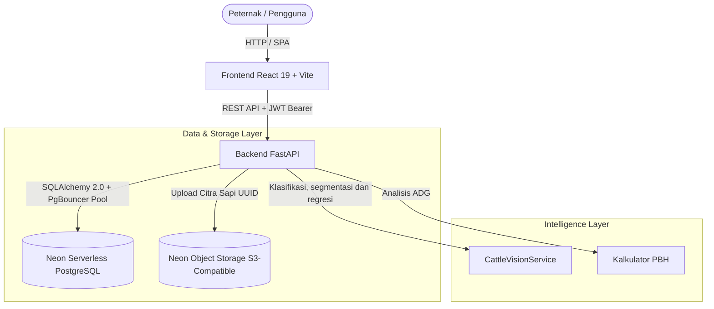

# TimbangDulu — Platform Digital Estimasi Bobot Sapi & Pemantauan PBH

<div align="center">


**Solusi Modern Manajemen Peternakan Sapi Berbasis Computer Vision & Analisis Pertumbuhan Harian**

[](https://fastapi.tiangolo.com)
[](https://react.dev)
[-4169E1?style=flat&logo=postgresql&logoColor=white)](https://neon.tech)
[](https://python.org)
[]()

</div>

---

## 📖 Tentang TimbangDulu

**TimbangDulu** adalah platform fullstack yang dirancang untuk membantu peternak sapi dalam memantau pertumbuhan ternak secara efisien tanpa memerlukan timbangan mekanis/digital konvensional berukuran besar. 

Dengan satu foto ternak dari samping atau belakang, sistem memverifikasi keberadaan sapi, mengestimasi bobot, dan mencatat **Perkembangan Bobot Harian (PBH)**. Pengaturan model tersedia di [panduan backend](backend/README.md#memilih-model-penimbangan).

---

## 🏗️ Arsitektur Sistem & Integrasi

Proyek ini dibangun dengan pendekatan decoupled monorepo:

```text
TimbangDulu/
├── frontend/        # Single Page Application (SPA) - React 19, Vite, Recharts, Three.js
├── backend/         # REST API Service - FastAPI, SQLAlchemy 2.0, Pydantic, Neon PostgreSQL
└── model_prediksi/  # Classifier sapi, model segmentasi dan regresi bobot
```



### 1. Database Relasional: Neon Serverless PostgreSQL
- Menggunakan **Neon PostgreSQL** dengan fitur *Connection Pooling* (`-pooler`).
- Dikonfigurasi secara resilient terhadap *cold start / auto-suspend* Neon (`connect_timeout=15s`, `pool_pre_ping=True`, `pool_recycle=300s`).
- Mengimplementasikan isolasi **Multi-Tenancy**: setiap peternak hanya dapat mengelola data sapi miliknya, dengan *unique constraint* `(id_user, ear_tag)`.

### 2. Penyimpanan Berkas Citra (Neon Object Storage)
> [!TIP]
> Backend dapat menyimpan foto ke bucket Neon `cattle-images` atau ke direktori `backend/uploads/` jika ketiga pengaturan koneksi S3 dikosongkan. Definisi bucket tersedia di [neon.ts](neon.ts).

### 3. Pipeline Inferensi Bobot & Analitik PBH
- **Inferensi bobot** menggunakan classifier terpilih untuk memeriksa satu foto. Model regresi mengestimasi bobot dari foto dan masker segmentasinya.
- **Kalkulator PBH:** Menghitung laju pertumbuhan:
  $$\text{PBH} = \frac{\Delta\text{Bobot}}{\Delta\text{Hari}} = \frac{\text{Bobot Akhir} - \text{Bobot Awal}}{\text{Jumlah Hari}}$$
  Dilengkapi peringatan dini (`PERINGATAN_PENURUNAN`) jika bobot ternak menyusut.

---

## 🚦 Status Integrasi Komponen (Development Snapshot)

| Modul | Sub-Komponen | Status | Keterangan |
| :--- | :--- | :---: | :--- |
| **Backend Auth** | JWT + Bcrypt Hashing | ✅ Selesai | Registrasi, Login, Route Guards, Multi-tenancy |
| **Backend Sapi** | CRUD Sapi & Jenis Sapi | ✅ Selesai | Transaksi atomik bobot awal manual, Soft-delete archive/unarchive |
| **Backend PBH** | ADG Engine & Validator | ✅ Selesai | Kalkulator mandiri + kalkulator historis antar pengukuran |
| **Backend Storage**| Penyimpanan foto | ✅ Selesai | Bucket Neon atau disk lokal |
| **Backend Testing**| Pytest | ✅ Selesai | Verifikasi registrasi, inferensi, isolasi data, dan transaksi |
| **Frontend Auth** | Login & Register Pages | ✅ Selesai | Terhubung ke `/api/v1/auth`, JWT storage di localStorage, auto-redirect |
| **Frontend Cattle**| Manajemen & Detail Sapi | ✅ Selesai | Terhubung ke `/api/v1/sapi`, modal tambah sapi, tab aktif/arsip, grafik Recharts |
| **Frontend Ukur** | Halaman Pengukuran Citra | ✅ Terhubung | Foto dan identitas sapi dikirim ke API penimbangan |
| **Frontend Dash** | Dashboard Statistik | ✅ Terhubung | Menampilkan riwayat dan ringkasan peternakan pengguna |
| **AI Model** | Pemeriksaan sapi dan estimasi bobot | ✅ Terhubung | Classifier Keras bawaan, segmentasi dan regresi dari `model_prediksi/` |

---

## 💻 Panduan Menjalankan Proyek (Local Setup)

### 1. Prasyarat
- **Node.js** 20.19.x atau 22.12+ dan **npm**
- **Python** 3.12 (versi yang diuji)
- SQLite lokal atau database **PostgreSQL**
- (Opsional) Kredensial **Neon Object Storage** untuk Bucket `cattle-images` (bisa ditarik via `neon env pull`)

---

### 2. Setup Backend (FastAPI)

1. Masuk ke direktori backend:
   ```bash
   cd backend
   ```

2. Buat dan aktifkan Python Virtual Environment:
   ```bash
   # Windows PowerShell
   python -m venv .venv
   .\.venv\Scripts\Activate.ps1

   # Linux / macOS
   python3 -m venv .venv
   source .venv/bin/activate
   ```

3. Pasang dependensi backend:
   ```bash
   pip install -r requirements.txt
   ```

4. Konfigurasi variabel lingkungan:
   Salin `.env.example` ke `.env` lalu sesuaikan isinya:
   ```bash
   cp .env.example .env
   ```
   *Contoh isi `.env` minimal:*
   ```env
   PROJECT_NAME="TimbangDulu API"
   VERSION="1.0.0"
   API_V1_STR="/api/v1"

   # Neon PostgreSQL Connection Pooling
   DATABASE_URL="postgresql://<user>:<password>@<ep-pooler-host>.us-east-2.aws.neon.tech/<dbname>?sslmode=require"

   # Isi ketiganya bila menggunakan Neon Object Storage
   AWS_ENDPOINT_URL_S3=""
   AWS_ACCESS_KEY_ID=""
   AWS_SECRET_ACCESS_KEY=""
   AWS_REGION="us-east-2"
   NEON_STORAGE_BUCKET_NAME="cattle-images"

   # Keamanan JWT
   SECRET_KEY="buat-kunci-rahasia-acak-minimal-32-karakter"
   ALGORITHM="HS256"
   ACCESS_TOKEN_EXPIRE_MINUTES=1440

   CATTLE_CLASSIFIER_PATH=../model_prediksi/sapibukan_cifor.keras
   ```

5. Inisialisasi skema tabel & data master:
   ```bash
   python -m app.db.init_db
   ```

6. Jalankan server backend:
   ```bash
   python main.py
   ```
   API aktif di `http://127.0.0.1:8000`.
   - Dokumentasi Swagger UI: `http://127.0.0.1:8000/docs`
   - Dokumentasi ReDoc: `http://127.0.0.1:8000/redoc`

---

### 3. Setup Frontend (React 19 + Vite)

1. Buka terminal baru dan masuk ke direktori frontend:
   ```bash
   cd frontend
   ```

2. Pasang dependensi frontend:
   ```bash
   npm install
   ```

3. Jalankan development server:
   ```bash
   npm run dev
   ```
   Aplikasi frontend aktif di `http://localhost:5173`.

---

## 🧪 Pengujian Otomatis (Automated Testing)

Jalankan rangkaian pengujian unit dan integrasi backend:
```bash
cd backend
pytest -v
```

Untuk menguji koneksi langsung (*live*) ke database Neon PostgreSQL aktif:
```bash
python tests/verify_neon_registration.py
python tests/verify_neon_sapi_crud.py
```

---

## 🗺️ Roadmap & Prioritas Selanjutnya

- [x] Form pengukuran terhubung ke `POST /api/v1/pengukuran/predict`.
- [x] Dashboard memuat ringkasan melalui `GET /api/v1/dashboard`.
- [x] Backend memuat model dari `model_prediksi/`.

---

## 👥 Tim & Kontribusi

Proyek ini dikembangkan untuk digitalisasi pemantauan peternakan sapi presisi.
Lisensi dan hak cipta dilindungi untuk keperluan riset dan pengembangan proyek TimbangDulu.
